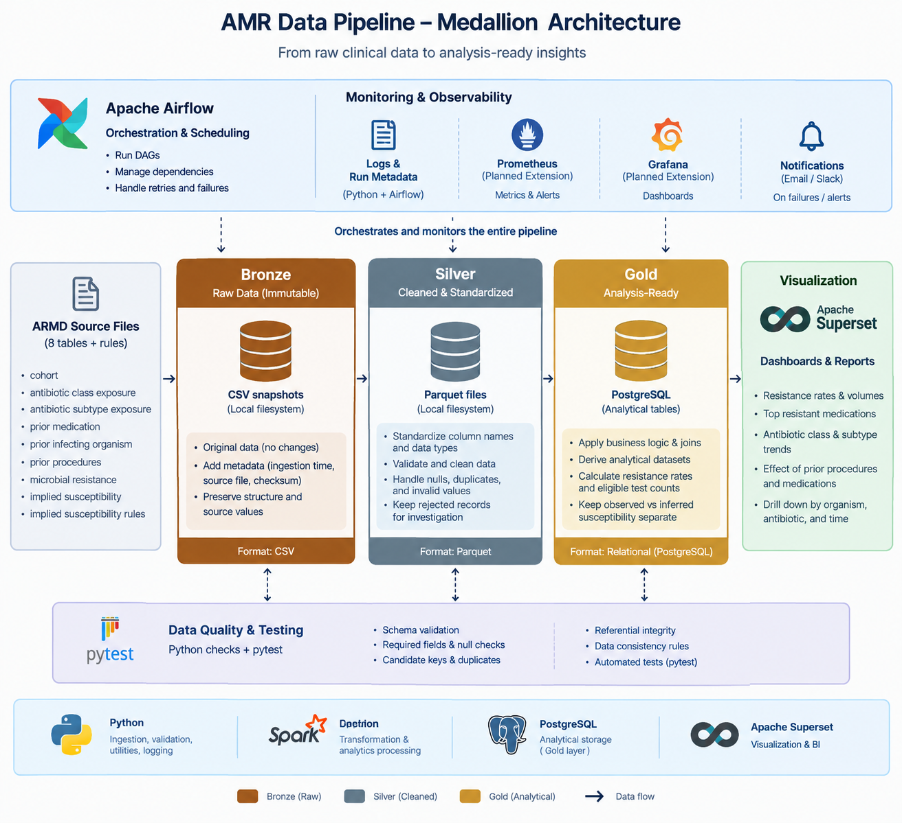
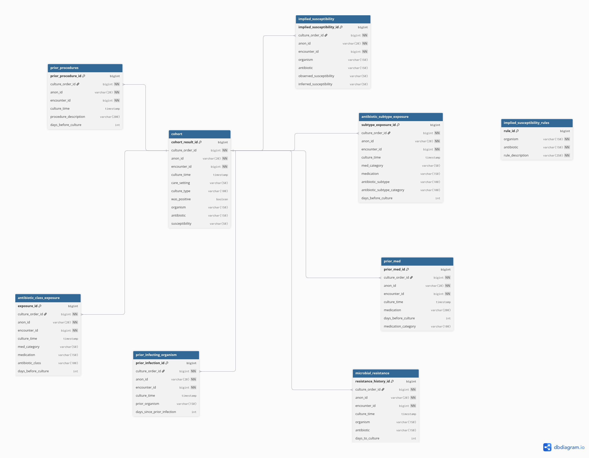
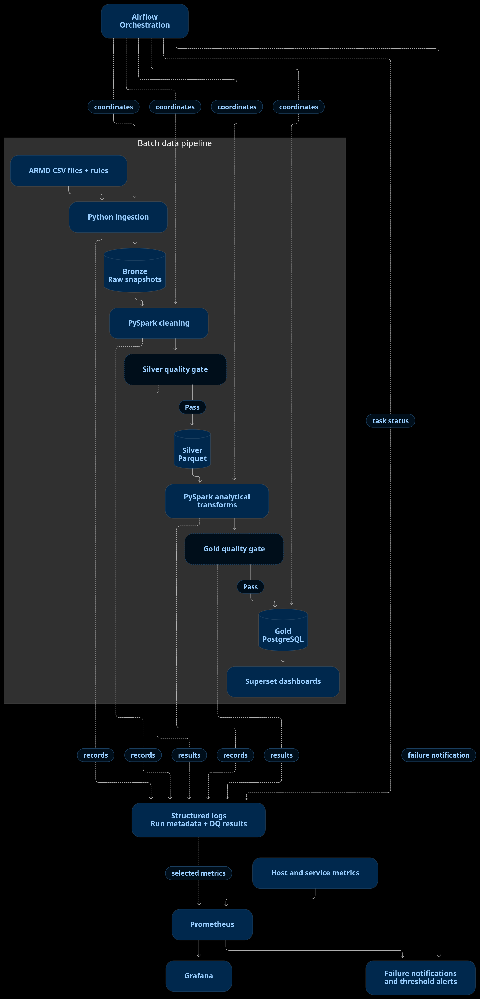

# AMR Data Pipeline — Project Design

## 1. Overview

**AMR Data Pipeline** is an end-to-end batch data engineering project designed to transform clinical microbiology and antimicrobial resistance data into validated, analysis-ready datasets.

The project uses the Antibiotic Resistance Microbiology Dataset (ARMD) as its primary data source. It focuses on integrating microbiology culture and susceptibility results with antibiotic exposure, prior infection, procedure history, and resistance-history data.

The pipeline follows a medallion architecture, separating raw source data, standardized datasets, and analytical outputs. Apache Airflow orchestrates the workflow, PySpark handles data transformations, PostgreSQL serves curated analytical datasets, and Apache Superset supports visualization.

The project also incorporates data-quality checks, automated testing, execution logging, and monitoring to make pipeline runs reproducible and easier to troubleshoot.

## 2. Problem Statement

Antimicrobial resistance (AMR) is a significant public health challenge that reduces the effectiveness of antimicrobial treatments. Inappropriate antimicrobial use can contribute to resistance, while previous infections, antibiotic exposure, and clinical procedures may also be associated with subsequent resistance patterns.

The ARMD dataset contains microbiology results and related clinical history across multiple source tables. Preparing these records for analysis requires understanding their structure, validating their relationships, standardizing their values, and transforming them into datasets suitable for reliable analytical queries.

This project addresses that data engineering challenge by building a reproducible batch pipeline that ingests, validates, transforms, and serves the selected data for antimicrobial resistance analysis.

The project investigates associations in the available observational data; it does not assume that antibiotic exposure, prior infections, or procedures directly cause a particular resistance outcome.

## 3. Objectives

The primary objectives are to:

1. **Investigate antibiotic exposure and resistance:** Examine how observed resistance outcomes vary across prior antibiotic exposure groups, including antibiotic classes, subtypes, and exposure timing.
2. **Analyze procedure history:** Investigate associations between prior procedures and subsequent culture susceptibility results.
3. **Examine prior infecting organisms:** Explore how previous organism history and the timing of prior infections relate to resistance patterns in subsequent cultures.
4. **Produce reliable analytical datasets:** Standardize and integrate source data while preserving the meaning and provenance of the original records.
5. **Validate data quality and analytical results:** Implement automated checks and compare selected pipeline outputs with findings from the existing antibiotic resistance analytics project.
6. **Monitor pipeline execution:** Track task status, processing duration, record counts, data-quality outcomes, failures, and relevant system resources.

## 4. Project Scope

### In scope

- Batch ingestion of selected ARMD CSV files.
- Raw data preservation and ingestion metadata.
- Schema and data-type standardization.
- Data profiling and validation of candidate keys and relationships.
- Transformation using PySpark.
- Parquet storage for the raw and standardized data layers.
- Analytical dataset preparation and loading into PostgreSQL.
- Automated data-quality checks and tests.
- Workflow orchestration using Apache Airflow.
- Pipeline logging and execution monitoring.
- Apache Superset dashboards.
- Validation of selected analytical outputs against the existing analytics project.

### Out of scope for the initial version

- Real-time or streaming ingestion.
- Distributed Spark clusters.
- Cloud-based data storage.
- Kubernetes-based deployment.
- Production-grade high-availability infrastructure.
- Causal inference or clinical decision-making.
- Automatic inference of susceptibility beyond validated source rules.

The initial implementation prioritizes a working, testable end-to-end batch pipeline. Additional infrastructure can be introduced later if the project's requirements justify it.

## 5. Data Source and Selected Tables

The primary source is the Antibiotic Resistance Microbiology Dataset (ARMD).

- Dataset documentation: [Dryad — DOI 10.5061/dryad.jq2bvq8kp](https://doi.org/10.5061/dryad.jq2bvq8kp)
- Research paper: [arXiv:2503.07664](https://arxiv.org/abs/2503.07664)

The initial pipeline uses eight data tables and one supporting rules file.

| Source table | Purpose |
|---|---|
| `microbiology_cultures_cohort` | Core culture, organism, antibiotic, and susceptibility observations |
| `microbiology_cultures_antibiotic_class_exposure` | Prior antibiotic exposure categorized by antibiotic class |
| `microbiology_cultures_antibiotic_subtype_exposure` | Prior antibiotic exposure categorized by subtype |
| `microbiology_cultures_prior_med` | Prior medication records associated with culture events |
| `microbiology_cultures_prior_infecting_organism` | Historical infecting organism information |
| `microbiology_cultures_priorprocedures` | Procedure history associated with culture events |
| `microbiology_cultures_microbial_resistance` | Resistance-history observations requiring temporal interpretation |
| `microbiology_cultures_implied_susceptibility` | Observed and inferred susceptibility information |
| `implied_susceptibility_rules.csv` | Supporting rules for interpreting implied susceptibility |

The cohort table is the primary source of observed microbiology and susceptibility outcomes. The remaining data tables provide additional exposure and historical context.

The implied susceptibility rules file is treated as reference data rather than a clinical event table.

Source filenames, column names, data types, record counts, and relationships will be verified during profiling. The final implementation will document any source-to-model naming differences.

## 6. Architecture

The pipeline follows a medallion architecture with Bronze, Silver, and Gold layers.

### 6.1 Bronze — Raw data

**Purpose:** Preserve the source data and establish a traceable ingestion boundary.

Responsibilities:

- Stage the original CSV files in the local filesystem.
- Preserve source values and file structure.
- Record metadata such as source filename, ingestion timestamp, and file checksum.
- Associate ingested files with a pipeline run where applicable.
- Avoid silently modifying or overwriting the source data.

### 6.2 Silver — Standardized and validated data

**Purpose:** Produce consistent datasets suitable for reliable transformations.

Responsibilities:

- Read the Bronze data using PySpark.
- Standardize column names and data types.
- Validate required fields and expected categorical values.
- Inspect nulls, duplicates, candidate keys, and referential integrity.
- Normalize values where justified and documented.
- Preserve rejected or quarantined records for investigation.
- Write standardized datasets in Parquet format.

### 6.3 Gold — Analysis-ready data

**Purpose:** Prepare datasets that directly support the project's analytical objectives.

Responsibilities:

- Calculate resistance outcomes using validated susceptibility categories.
- Include eligible test counts alongside resistance rates.
- Analyze resistance outcomes across antibiotic exposure groups.
- Prepare datasets for procedure history and prior infecting organisms.
- Keep observed and inferred susceptibility distinguishable.
- Load validated analytical tables into PostgreSQL.

Gold datasets will be designed around explicit analytical grains. Separate datasets will be preferred over one large table when combining the source tables would introduce ambiguous relationships or row multiplication.

## 7. Data Model

The initial data model identifies the cohort results as the central microbiology records, with antibiotic exposure, medication history, infection history, procedure history, resistance history, and implied susceptibility represented separately.

The model is a starting point for understanding the source relationships, not a claim that every proposed relationship has already been verified.

Before implementing database constraints or joins, the pipeline will validate:

- Whether the culture order identifier is unique in any given table.
- Whether a culture order contains multiple organisms or antibiotic results.
- Whether the same culture order has multiple exposure, medication, or procedure records.
- Whether the linking keys are populated and consistent across the selected tables.
- Whether candidate keys identify records at the intended grain.

Surrogate identifiers may be introduced in the analytical warehouse where useful. They will not replace the need to understand source-level record identity.

## 8. Batch Data Flow

The expected execution sequence is:

1. **Ingestion:** Python stages source files and records ingestion metadata.
2. **Bronze storage:** Raw source snapshots are preserved.
3. **Silver transformation:** PySpark standardizes source data and performs initial validation.
4. **Silver quality gate:** Automated checks determine whether the standardized data can proceed.
5. **Gold transformation:** PySpark prepares analytical datasets at their defined grains.
6. **Gold quality gate:** Analytical results and business rules are validated.
7. **Warehouse loading:** Validated Gold datasets are loaded into PostgreSQL.
8. **Visualization:** Superset queries the curated datasets to produce dashboards.

Apache Airflow coordinates task dependencies, execution, retries, and failure handling. Logging and monitoring capture information from the ingestion, transformation, validation, and loading stages.

A failed quality gate should prevent the affected data from being treated as a successfully validated output.

## 9. Technology Stack

| Technology | Responsibility |
|---|---|
| Python | Ingestion, utilities, logging, validation, and pipeline support |
| PySpark | Data standardization, transformation, joining, and aggregation |
| Parquet | Columnar storage for standardized datasets |
| Apache Airflow | Batch workflow orchestration and scheduling |
| PostgreSQL | Storage and serving of curated analytical datasets |
| Apache Superset | Analytical dashboards and visual exploration |
| pytest | Automated tests for transformation and validation logic |
| Python data-quality checks | Runtime validation of actual pipeline data |
| Linux utilities | Initial inspection of CPU, memory, disk, and process usage |
| Prometheus and Grafana | Planned extension for metrics collection and monitoring dashboards |

The initial implementation will run locally. Distributed processing and additional infrastructure will be considered only if they provide a clear benefit.

## 10. Data Quality and Testing

Data quality is enforced throughout the pipeline rather than treated as a final cleanup step.

Initial checks will cover:

- **Schema validation:** Expected columns and compatible data types.
- **Required fields:** Missing values in fields required for specific transformations.
- **Record integrity:** Candidate-key uniqueness and duplicate investigation.
- **Relationship integrity:** Key coverage and join cardinality between source tables.
- **Value validation:** Unexpected categorical values and invalid time intervals.
- **Transformation correctness:** Tests for derived fields, aggregations, and resistance calculations.
- **Reconciliation:** Input/output counts and comparison of selected analytical outputs against established baselines.

Duplicate records will not be removed automatically without understanding whether they represent redundant data or distinct clinical events.

Observed susceptibility results and inferred susceptibility results will be tracked separately. The source rules will be validated before they are used to derive additional results.

## 11. Monitoring and Observability

Monitoring will cover pipeline execution, data quality, and system resources.

### Pipeline monitoring

Apache Airflow and application logs will provide visibility into:

- DAG and task status.
- Task execution duration and retries.
- Failed tasks and error messages.
- Batch execution history.

### Data monitoring

Each run will record relevant operational metadata, including:

- Run identifier and timestamps.
- Source file identifiers or checksums.
- Input and output row counts.
- Rejected-record counts.
- Quality-check outcomes.
- Processing duration and execution status.

These records will initially be available through structured logs and may also be persisted in a PostgreSQL audit table.

### System monitoring

Linux utilities will provide initial visibility into CPU, memory, disk space, and process health.

Prometheus and Grafana are planned extensions for collecting and visualizing metrics. Their integration will follow once the core pipeline and its logging are working reliably.

Monitoring outputs will avoid exposing patient-level clinical information.

## 12. Analytical Outputs

The initial Gold layer is expected to contain separate analytical datasets such as:

### Resistance analysis

- Resistance rate by organism and tested antibiotic.
- Number of eligible tests and resistant results.
- Trends or comparisons where time and data coverage permit.

### Antibiotic exposure analysis

- Resistance outcomes across prior antibiotic class and subtype exposure groups.
- Exposure timing where the source fields support a reliable interpretation.
- Group sizes to help contextualize observed differences.

### Procedure history analysis

- Resistance outcomes across groups defined by prior procedure history.
- Timing of procedures relative to culture collection where supported by the source data.

### Prior infection analysis

- Resistance outcomes grouped by prior infecting organism.
- Historical infection timing where the source fields are interpretable.

### Susceptibility comparison

- Comparison of observed and inferred susceptibility records.
- Counts of records with observed, inferred, or unavailable results.
- Clear documentation of the rules used for inference.

These outputs are proposed deliverables. Their exact metrics and dimensions will be finalized after profiling the source data and validating the meaning of the available fields.

## 13. Analytical Considerations

The project will apply the following principles:

- Resistance rates will use eligible tested results as the denominator, with excluded categories documented.
- Test counts will accompany percentages to expose small denominators.
- Inferred susceptibility will not be silently treated as equivalent to observed susceptibility.
- Historical time intervals will be interpreted only after confirming their definitions and sign conventions.
- Joins will be checked for fan-out and unintended row multiplication.
- Observational associations will not be presented as proof of causation.
- Findings will be reconciled with the existing analytics project where comparable definitions and source coverage permit.

## 14. Implementation Plan

The project is planned as a three-week MVP, with approximately 30 minutes of work per day.

### Week 1 — Design and core data preparation

- Finalize project design and architecture.
- Profile source tables and document schemas.
- Verify candidate keys, data grains, and relationships.
- Establish the repository structure and test setup.
- Implement the initial Bronze-to-Silver path.

### Week 2 — Transformation and orchestration

- Implement the remaining Silver transformations.
- Build and validate Gold analytical datasets.
- Add runtime quality gates and automated tests.
- Load analytical outputs into PostgreSQL.
- Create the Airflow DAG and run an end-to-end batch.

### Week 3 — Monitoring, visualization, and validation

- Complete the core execution logs and monitoring metadata.
- Connect Superset to PostgreSQL.
- Build the initial analytical dashboards.
- Compare selected outputs with the existing analytics project.
- Document the pipeline, tests, limitations, and execution instructions.

Prometheus and Grafana integration may be deferred if necessary to protect the core pipeline, validation, and analytical deliverables.

## 15. Expected Deliverables

By the end of the initial implementation, the project should provide:

- A reproducible batch ingestion and transformation workflow.
- Bronze, Silver, and Gold data layers.
- Validated, analysis-ready PostgreSQL tables.
- Automated tests and data-quality checks.
- An orchestrated Airflow workflow.
- Execution logs and batch-level monitoring metadata.
- Superset dashboards for the selected analytical questions.
- Documentation covering architecture, data relationships, quality rules, and limitations.
- A comparison of selected pipeline outputs against the existing analytics baseline.

## 16. Success Criteria

The MVP will be considered complete when:

- The selected source files can be ingested reproducibly.
- Source data is preserved and transformations are documented.
- Candidate keys and important table relationships have been investigated.
- Required quality gates execute and fail appropriately when checks are violated.
- Gold datasets can be loaded and queried in PostgreSQL.
- The Airflow workflow completes successfully for a validated batch.
- Superset can display the agreed analytical outputs.
- Selected results have been reconciled against the existing analytics baseline where comparable.
- Logs and run metadata make it possible to investigate failures and understand what each batch processed.
- Setup, execution, testing, and known limitations are documented.

---

**Project status:** Design and source profiling

**Primary dataset:** Antibiotic Resistance Microbiology Dataset (ARMD)

**Processing approach:** Local batch processing using a medallion architecture