# Silver Data Dictionary

## 1. Purpose

The Silver layer contains standardized, validated, and documented datasets derived from the Bronze layer of the AMR Data Pipeline.

The pipeline uses the Stanford Healthcare Antibiotic Resistance Microbiology Dataset (ARMD) to support analysis of:

- Culture and susceptibility observations.
- Historical microbial resistance observations.
- Prior antibiotic class and subtype exposure.
- Prior infecting organisms.
- Prior medication records.
- Prior clinical procedures.
- Observed and implied susceptibility.
- Rules used to infer susceptibility.

Silver datasets retain the source information needed for downstream analysis while applying documented column-name standardization, data-type conversions, missing-value handling, data-quality checks, and justified deduplication.

Silver is not an analytical aggregation layer. It preserves the individual observations required to build Gold datasets later.

## 2. Scope and conventions

### 2.1 Source and storage

| Property | Description |
|---|---|
| Source | Stanford Healthcare Antibiotic Resistance Microbiology Dataset (ARMD) |
| Source format | CSV |
| Input layer | Bronze |
| Output layer | Silver |
| Storage format | Parquet |
| Processing engine | PySpark |
| Orchestration | Apache Airflow |
| Downstream consumers | Gold datasets, PostgreSQL, and Apache Superset |

### 2.2 General transformation conventions

1. Bronze preserves source column names and source records.
2. Silver applies the standardized names defined in this document.
3. Source identifiers are preserved; their types must be validated against the source schemas and observed values.
4. `order_time_jittered_utc` is standardized to `culture_time` and parsed consistently as a timestamp.
5. Source interval fields are converted to appropriate numeric types only after checking their values. Their units and direction must not be assumed from column names alone.
6. Actual null values, empty strings, and literal strings such as `"Null"` must be distinguished.
7. Observed susceptibility and implied susceptibility remain separate attributes.
8. Exact duplicate removal is permitted only under a documented policy.
9. Repeated candidate-key combinations must not be treated as duplicate records without further evidence.
10. Relationships between datasets must be validated before joins are used downstream.
11. Records that fail validation must be handled explicitly and accounted for in data-quality results.
12. Input counts, output counts, rejected records, deduplication counts, and data-quality outcomes must be recorded for each pipeline run.

### 2.3 Data-type conventions

The types in this document describe the intended logical schema. They must be reconciled with the actual PySpark schemas and source values during implementation.

| Logical type | Intended meaning |
|---|---|
| `STRING` | Text, categorical values, or identifiers whose source representation must be preserved |
| `BIGINT` | Integer identifiers or integer values requiring 64-bit storage |
| `INT` | Integer-valued interval fields, subject to validation |
| `TIMESTAMP` | Parsed culture timestamp |
| `BOOLEAN` | True/false indicator, subject to validation of the source representation |

The logical types above are not a substitute for source-schema validation. In particular, an identifier should not be converted to a numeric type merely because its values look numeric; the conversion must be consistent with the documented source schema and intended use.

## 3. Silver dataset inventory

| Silver dataset | Bronze source file | Intended grain |
|---|---|---|
| `silver_culture_cohort` | `microbiology_cultures_cohort.csv` | Culture order × organism × antibiotic result |
| `silver_prior_medication` | `microbiology_cultures_prior_med.csv` | Culture order × prior medication record |
| `silver_prior_infecting_organism` | `microbiology_culture_prior_infecting_organism.csv` | Culture order × prior-infection observation |
| `silver_antibiotic_class_exposure` | `microbiology_cultures_antibiotic_class_exposure.csv` | Culture order × antibiotic class exposure record |
| `silver_prior_procedure` | `microbiology_cultures_priorprocedures.csv` | Culture order × prior procedure observation |
| `silver_antibiotic_subtype_exposure` | `microbiology_cultures_antibiotic_subtype_exposure.csv` | Culture order × antibiotic subtype exposure record |
| `silver_microbial_resistance` | `microbiology_cultures_microbial_resistance.csv` | Culture order × organism × antibiotic resistance-history observation |
| `silver_implied_susceptibility` | `microbiology_cultures_implied_susceptibility.csv` | Culture order × organism × antibiotic susceptibility observation |
| `silver_susceptibility_rules` | Source reference CSV containing `Organism`, `Antibiotic`, and `Rule` | Organism × antibiotic rule |

The dataset names above are proposed logical names. Physical directory names and table names should be consistent with the pipeline's implementation conventions.

The intended grain describes the type of observation represented by a row. It does not assert that the listed attributes form a unique key.

## 4. Standardized column names

The following mappings define the standardized Silver names. Original names must remain unchanged in Bronze.

| Original source column | Standardized Silver column | Applies to |
|---|---|---|
| `pat_enc_csn_id_coded` | `encounter_id` | All applicable event datasets |
| `order_proc_id_coded` | `culture_order_id` | All applicable event datasets |
| `order_time_jittered_utc` | `culture_time` | Datasets containing the culture timestamp |
| `ordering_mode` | `care_setting` | Culture cohort |
| `culture_description` | `culture_type` | Culture cohort |
| `prior_infecting_organism_days_to_culutre` | `days_since_prior_infection` | Prior infecting organism |
| `medication_category` | `med_category` | Applicable medication/exposure datasets |
| `medication_name` | `medication` | Applicable medication/exposure datasets |
| `time_to_culturetime` | `days_before_culture` | Antibiotic class exposure |
| `hosp_ward_IP` | `is_inpatient` | Culture cohort, if present in the source |
| `hosp_ward_OP` | `is_outpatient` | Culture cohort, if present in the source |
| `hosp_ward_ER` | `is_er` | Culture cohort, if present in the source |
| `hosp_ward_ICU` | `is_icu` | Culture cohort, if present in the source |
| `antibiotic_subtype` | `subtype` | Antibiotic subtype exposure |
| `antibiotic_subtype_category` | `subtype_category` | Antibiotic subtype exposure |
| `procedure_description` | `procedure_name` | Prior procedure |
| `procedure_time_to_culturetime` | `days_since_prior_procedure` | Prior procedure |
| `medication_time_to_culturetime` | `days_since_prior_medication` | Applicable medication datasets |

### 4.1 Source spelling and casing exceptions

Some source column names differ from their documented standardized mappings because of source spelling or casing inconsistencies.

| Dataset | Actual source column | Standardized Silver column |
|---|---|---|
| Prior infecting organism | `prior_infecting_organism_days_to_culutre` | `days_since_prior_infection` |
| Antibiotic subtype exposure | `medication_time_to_cultureTime` | `days_since_prior_medication` |

The transformation must explicitly handle these actual source names. Column standardization must not depend on the assumption that the source spelling is always identical across files.

### 4.2 Additional naming decision requiring resolution

The antibiotic class exposure schema contains `antibiotic_class`, while the proposed schema documentation has used `class` in some places.

No standardized mapping for `antibiotic_class` to `class` has been established in the column-renaming table.

Until that mapping is explicitly approved, retain `antibiotic_class` in Silver rather than silently introducing a different column name.

### 4.3 Interval fields without an approved standardized mapping

The source column `resistant_time_to_culturetime` is retained under its current name in the proposed Silver schema. No alternative standardized name has been established in the column-renaming table.

Its type and meaning must be validated before it is used to calculate temporal summaries.

## 5. Dataset schemas

The following schemas specify the intended Silver structure. Types and nullability must be verified against actual source data and transformation outputs before being treated as final implementation contracts.

### 5.1 Culture cohort

**Source:** `microbiology_cultures_cohort.csv`

**Proposed Silver dataset:** `silver_culture_cohort`

**Grain:** Culture order × organism × antibiotic result.

| Column | Logical type | Nullable | Description |
|---|---|---|---|
| `anon_id` | `STRING` | Validate | De-identified patient identifier |
| `encounter_id` | `BIGINT` | Validate | Standardized patient encounter identifier |
| `culture_order_id` | `BIGINT` | No, based on profiling | Standardized culture order identifier |
| `culture_time` | `TIMESTAMP` | Validate | Parsed, jittered timestamp associated with the culture |
| `care_setting` | `STRING` | Validate | Source ordering mode or care setting |
| `culture_type` | `STRING` | Validate | Description or type of culture |
| `was_positive` | `BOOLEAN` | Validate | Indicator of whether the culture was positive |
| `organism` | `STRING` | Validate | Organism associated with the culture result |
| `antibiotic` | `STRING` | Validate | Antibiotic associated with the susceptibility observation |
| `susceptibility` | `STRING` | Validate | Source-reported susceptibility interpretation |
| `is_inpatient` | `BOOLEAN` | Validate | Indicator derived from `hosp_ward_IP`, if present |
| `is_outpatient` | `BOOLEAN` | Validate | Indicator derived from `hosp_ward_OP`, if present |
| `is_er` | `BOOLEAN` | Validate | Indicator derived from `hosp_ward_ER`, if present |
| `is_icu` | `BOOLEAN` | Validate | Indicator derived from `hosp_ward_ICU`, if present |

**Implementation notes**

- Confirm the actual source columns before enforcing the schema, especially the four ward indicators.
- Validate the source representation of `was_positive` and ward indicators before casting to Boolean.
- Do not assume `culture_order_id` uniquely identifies a result row.
- Profiling found repeated culture order identifiers and repeated `culture_order_id` + `organism` + `antibiotic` combinations.
- Preserve distinct observations unless a documented rule justifies excluding them.
- A row-level surrogate key such as `cohort_result_id` may be introduced when required by the implemented model. It must be generated using a strategy appropriate for the key's intended persistence and relationship requirements.

### 5.2 Prior medication

**Source:** `microbiology_cultures_prior_med.csv`

**Proposed Silver dataset:** `silver_prior_medication`

**Grain:** Culture order × prior medication record.

| Column | Logical type | Nullable | Description |
|---|---|---|---|
| `anon_id` | `STRING` | Validate | De-identified patient identifier |
| `encounter_id` | `BIGINT` | Validate | Standardized patient encounter identifier |
| `culture_order_id` | `BIGINT` | No, based on profiling | Standardized culture order identifier |
| `culture_time` | `TIMESTAMP` | Validate | Parsed, jittered culture timestamp |
| `medication` | `STRING` | Validate | Medication name |
| `med_category` | `STRING` | Validate | Medication category |
| `days_since_prior_medication` | `INT` | Validate | Numeric source interval associated with the medication and culture |

**Transformation and quality notes**

- Standardize `medication_name` to `medication`.
- Standardize `medication_category` to `med_category`.
- Standardize `medication_time_to_culturetime` to `days_since_prior_medication`.
- Validate the interval values before conversion to an integer type.
- The source contains a substantial number of exact repeated rows.
- The proposed Silver policy is to retain one copy of each distinct complete source row while preserving the unchanged source data in Bronze.
- Record the number of input rows, retained rows, and removed exact copies for every run.
- Do not deduplicate using a candidate key alone.
- The precise meaning of repeated medication observations remains subject to validation.

### 5.3 Prior infecting organism

**Source:** `microbiology_culture_prior_infecting_organism.csv`

**Proposed Silver dataset:** `silver_prior_infecting_organism`

**Grain:** Culture order × prior-infection observation.

| Column | Logical type | Nullable | Description |
|---|---|---|---|
| `anon_id` | `STRING` | Validate | De-identified patient identifier |
| `encounter_id` | `BIGINT` | Validate | Standardized patient encounter identifier |
| `culture_order_id` | `BIGINT` | No, based on profiling | Standardized culture order identifier |
| `culture_time` | `TIMESTAMP` | Validate | Parsed, jittered culture timestamp |
| `prior_organism` | `STRING` | Validate | Previously recorded infecting organism |
| `days_since_prior_infection` | `INT` | Validate | Standardized numeric interval associated with the prior infection |

**Transformation and quality notes**

- The actual source column contains the typo `prior_infecting_organism_days_to_culutre`.
- Rename that source column to `days_since_prior_infection` in Silver.
- The source contains repeated `culture_order_id` + `prior_organism` combinations.
- The same order and organism can occur with different interval values.
- Do not treat `culture_order_id` + `prior_organism` as a unique key.
- Validate the interval type and semantics without assuming its units or direction.
- No exact duplicate rows were detected during profiling.

### 5.4 Antibiotic class exposure

**Source:** `microbiology_cultures_antibiotic_class_exposure.csv`

**Proposed Silver dataset:** `silver_antibiotic_class_exposure`

**Grain:** Culture order × antibiotic class exposure record.

| Column | Logical type | Nullable | Description |
|---|---|---|---|
| `anon_id` | `STRING` | Validate | De-identified patient identifier |
| `encounter_id` | `BIGINT` | Validate | Standardized patient encounter identifier |
| `culture_order_id` | `BIGINT` | No, based on profiling | Standardized culture order identifier |
| `culture_time` | `TIMESTAMP` | Validate | Parsed, jittered culture timestamp |
| `med_category` | `STRING` | Validate | Medication category |
| `medication` | `STRING` | Validate | Medication name |
| `antibiotic_class` | `STRING` | Validate | Antibiotic class associated with the exposure |
| `days_before_culture` | `INT` | Validate | Numeric source interval from `time_to_culturetime` |

**Transformation and quality notes**

- Rename `medication_category` to `med_category`.
- Rename `medication_name` to `medication`.
- Rename `time_to_culturetime` to `days_before_culture`.
- Retain `antibiotic_class` unless a standardized replacement is explicitly approved.
- Validate interval values before conversion.
- Repeated order, medication, and class combinations exist and may have different interval values.
- Do not deduplicate using `culture_order_id` + `medication` + `antibiotic_class`.
- No exact duplicate rows were detected during profiling.

### 5.5 Prior procedure

**Source:** `microbiology_cultures_priorprocedures.csv`

**Proposed Silver dataset:** `silver_prior_procedure`

**Grain:** Culture order × prior procedure observation.

| Column | Logical type | Nullable | Description |
|---|---|---|---|
| `anon_id` | `STRING` | Validate | De-identified patient identifier |
| `encounter_id` | `BIGINT` | Validate | Standardized patient encounter identifier |
| `culture_order_id` | `BIGINT` | No, based on profiling | Standardized culture order identifier |
| `culture_time` | `TIMESTAMP` | Validate | Parsed, jittered culture timestamp |
| `procedure_name` | `STRING` | Validate | Standardized procedure description |
| `days_since_prior_procedure` | `INT` | Validate | Numeric source interval associated with the prior procedure |

**Transformation and quality notes**

- Rename `procedure_description` to `procedure_name`.
- Rename `procedure_time_to_culturetime` to `days_since_prior_procedure`.
- Validate interval values and conversion results.
- Repeated order and procedure combinations exist with different interval values.
- Do not assume `culture_order_id` + `procedure_name` uniquely identifies a procedure observation.
- No exact duplicate rows were detected during profiling.

### 5.6 Antibiotic subtype exposure

**Source:** `microbiology_cultures_antibiotic_subtype_exposure.csv`

**Proposed Silver dataset:** `silver_antibiotic_subtype_exposure`

**Grain:** Culture order × antibiotic subtype exposure record.

| Column | Logical type | Nullable | Description |
|---|---|---|---|
| `anon_id` | `STRING` | Validate | De-identified patient identifier |
| `encounter_id` | `BIGINT` | Validate | Standardized patient encounter identifier |
| `culture_order_id` | `BIGINT` | No, based on profiling | Standardized culture order identifier |
| `culture_time` | `TIMESTAMP` | Validate | Parsed, jittered culture timestamp |
| `med_category` | `STRING` | Validate | Medication category |
| `medication` | `STRING` | Validate | Medication name |
| `subtype` | `STRING` | Validate | Standardized antibiotic subtype |
| `subtype_category` | `STRING` | Validate | Category associated with the antibiotic subtype |
| `days_since_prior_medication` | `INT` | Validate | Standardized numeric interval from `medication_time_to_cultureTime` |

**Transformation and quality notes**

- Rename `medication_category` to `med_category`.
- Rename `medication_name` to `medication`.
- Rename `antibiotic_subtype` to `subtype`.
- Rename `antibiotic_subtype_category` to `subtype_category`.
- Normalize the source column's casing and rename `medication_time_to_cultureTime` to `days_since_prior_medication`.
- Validate the interval's numeric values and conversion results.
- Repeated order, medication, and subtype combinations exist.
- Some repeated combinations differ in subtype category.
- Do not deduplicate based on the candidate combination of culture order, medication, and subtype.
- No exact duplicate rows were detected during profiling.

### 5.7 Microbial resistance

**Source:** `microbiology_cultures_microbial_resistance.csv`

**Proposed Silver dataset:** `silver_microbial_resistance`

**Grain:** Culture order × organism × antibiotic resistance-history observation.

| Column | Logical type | Nullable | Description |
|---|---|---|---|
| `anon_id` | `STRING` | Validate | De-identified patient identifier |
| `encounter_id` | `BIGINT` | Validate | Standardized patient encounter identifier |
| `culture_order_id` | `BIGINT` | No, based on profiling | Standardized culture order identifier |
| `culture_time` | `TIMESTAMP` | Validate | Parsed, jittered culture timestamp |
| `organism` | `STRING` | Validate | Organism associated with the resistance observation |
| `antibiotic` | `STRING` | Validate | Antibiotic associated with the resistance observation |
| `resistant_time_to_culturetime` | `INT` | Validate | Source interval associated with the resistance observation |

**Transformation and quality notes**

- Standardize the identifier and timestamp columns.
- Preserve `resistant_time_to_culturetime` until a different standardized name is explicitly defined.
- Validate the interval field and document its units and direction only when supported by the source documentation.
- Repeated order, organism, and antibiotic combinations exist with different interval values.
- Do not treat `culture_order_id` + `organism` + `antibiotic` as a unique key.
- No exact duplicate rows were detected during profiling.
- Do not interpret the number of resistance-history observations as a resistance rate without a defensible denominator.

### 5.8 Implied susceptibility

**Source:** `microbiology_cultures_implied_susceptibility.csv`

**Proposed Silver dataset:** `silver_implied_susceptibility`

**Grain:** Culture order × organism × antibiotic susceptibility observation.

| Column | Logical type | Nullable | Description |
|---|---|---|---|
| `anon_id` | `STRING` | Validate | De-identified patient identifier |
| `encounter_id` | `BIGINT` | Validate | Standardized patient encounter identifier |
| `culture_order_id` | `BIGINT` | No, based on profiling | Standardized culture order identifier |
| `organism` | `STRING` | Validate | Organism associated with the susceptibility observation |
| `antibiotic` | `STRING` | Validate | Antibiotic associated with the susceptibility observation |
| `susceptibility` | `STRING` | Validate | Source-reported susceptibility interpretation |
| `implied_susceptibility` | `STRING` | Validate | Inferred susceptibility interpretation supplied by the source dataset |

**Transformation and quality notes**

- Preserve `susceptibility` and `implied_susceptibility` as separate columns.
- Do not overwrite an observed susceptibility value with an implied value.
- Literal `"Null"` values were present in both fields during profiling and were not detected by ordinary null checks.
- Define a consistent missing-value representation before normalizing literal `"Null"` values.
- Preserve other interpretation categories such as `Intermediate`, `No Interpretation`, `See Comment`, `Not done`, and other source values unless a documented standardization rule is introduced.
- Repeated order, organism, and antibiotic combinations exist.
- Profiling found repeated combinations with conflicting observed susceptibility values.
- Do not delete or resolve conflicting observations without an explicit, justified rule.
- No exact duplicate rows were detected during profiling.

### 5.9 Susceptibility rules

**Source:** Reference CSV containing `Organism`, `Antibiotic`, and `Rule`.

**Proposed Silver dataset:** `silver_susceptibility_rules`

**Grain:** Organism × antibiotic rule.

| Column | Logical type | Nullable | Description |
|---|---|---|---|
| `organism` | `STRING` | Validate | Organism to which the rule applies |
| `antibiotic` | `STRING` | Validate | Antibiotic to which the rule applies |
| `rule` | `STRING` | Validate | Source-defined rule used for susceptibility inference |

**Transformation and quality notes**

- Standardize `Organism` to `organism`.
- Standardize `Antibiotic` to `antibiotic`.
- Standardize `Rule` to `rule`.
- Validate whether organism and antibiotic combinations are unique before treating them as a key.
- Preserve the original rule text and meaning.
- Do not create new inference logic from the rule description without documenting and testing that logic separately.

## 6. Logical data model

### 6.1 Modeling approach

The Silver layer is modeled as a set of related datasets rather than a single wide table.

The source data contains multiple observations for the same culture order. A culture order identifier is therefore not a row-level primary key for all datasets.

The model distinguishes:

- The culture order as a logical parent entity.
- Culture result observations.
- Antibiotic class and subtype exposure observations.
- Prior medication observations.
- Prior infection observations.
- Prior procedure observations.
- Resistance-history observations.
- Implied susceptibility observations.
- Reference rules for susceptibility inference.

The purpose of this model is to preserve the different grains and prevent accidental row multiplication during joins.

### 6.2 Entity relationship diagram

The diagram below describes the intended logical relationships. It does not assert that every relationship has already been validated or that every entity must be materialized as a separate physical Silver table.

```mermaid
erDiagram
    CULTURE_ORDER ||--o{ CULTURE_COHORT : has
    CULTURE_ORDER ||--o{ PRIOR_MEDICATION : has
    CULTURE_ORDER ||--o{ PRIOR_INFECTING_ORGANISM : has
    CULTURE_ORDER ||--o{ ANTIBIOTIC_CLASS_EXPOSURE : has
    CULTURE_ORDER ||--o{ PRIOR_PROCEDURE : has
    CULTURE_ORDER ||--o{ ANTIBIOTIC_SUBTYPE_EXPOSURE : has
    CULTURE_ORDER ||--o{ MICROBIAL_RESISTANCE : has
    CULTURE_ORDER ||--o{ IMPLIED_SUSCEPTIBILITY : has

    SUSCEPTIBILITY_RULE ||--o{ IMPLIED_SUSCEPTIBILITY : informs

    CULTURE_ORDER {
        string anon_id
        bigint encounter_id
        bigint culture_order_id
        timestamp culture_time
    }

    CULTURE_COHORT {
        string anon_id
        bigint encounter_id
        bigint culture_order_id
        timestamp culture_time
        string organism
        string antibiotic
        string susceptibility
    }

    PRIOR_MEDICATION {
        string anon_id
        bigint encounter_id
        bigint culture_order_id
        timestamp culture_time
        string medication
        string med_category
        int days_since_prior_medication
    }

    PRIOR_INFECTING_ORGANISM {
        string anon_id
        bigint encounter_id
        bigint culture_order_id
        timestamp culture_time
        string prior_organism
        int days_since_prior_infection
    }

    ANTIBIOTIC_CLASS_EXPOSURE {
        string anon_id
        bigint encounter_id
        bigint culture_order_id
        timestamp culture_time
        string medication
        string med_category
        string antibiotic_class
        int days_before_culture
    }

    PRIOR_PROCEDURE {
        string anon_id
        bigint encounter_id
        bigint culture_order_id
        timestamp culture_time
        string procedure_name
        int days_since_prior_procedure
    }

    ANTIBIOTIC_SUBTYPE_EXPOSURE {
        string anon_id
        bigint encounter_id
        bigint culture_order_id
        timestamp culture_time
        string medication
        string med_category
        string subtype
        string subtype_category
        int days_since_prior_medication
    }

    MICROBIAL_RESISTANCE {
        string anon_id
        bigint encounter_id
        bigint culture_order_id
        timestamp culture_time
        string organism
        string antibiotic
        int resistant_time_to_culturetime
    }

    IMPLIED_SUSCEPTIBILITY {
        string anon_id
        bigint encounter_id
        bigint culture_order_id
        string organism
        string antibiotic
        string susceptibility
        string implied_susceptibility
    }

    SUSCEPTIBILITY_RULE {
        string organism
        string antibiotic
        string rule
    }
```

### 6.3 Culture order entity

`CULTURE_ORDER` is a logical parent entity representing a culture order.

Its proposed identifying attributes are:

- `culture_order_id`
- `anon_id`
- `encounter_id`
- `culture_time`

Before materializing this entity, validate whether `culture_order_id` uniquely and consistently identifies a culture order across the relevant datasets.

If `culture_order_id` is not a reliable standalone identifier, establish a validated composite business key or introduce a stable surrogate key.

A surrogate key must not be generated using an unstable row number if it will be used for persistent relationships across pipeline runs.

The culture order entity may be derived from the relevant source datasets. It must not be created by arbitrarily selecting a row when the order-level attributes conflict.

### 6.4 Culture result observations

A culture order may have multiple result observations.

The cohort dataset contains organism, antibiotic, and susceptibility attributes. Its row grain must therefore be preserved independently of the order-level entity.

A candidate combination of `culture_order_id`, `organism`, and `antibiotic` is not guaranteed to be unique.

If a row-level primary key is needed, introduce a surrogate key such as `cohort_result_id` under a documented key-generation strategy.

### 6.5 Exposure and clinical-history observations

The prior medication, antibiotic class exposure, antibiotic subtype exposure, prior infecting organism, and prior procedure datasets each preserve their own observations.

These datasets must not be joined directly to one another at row level without considering their respective grains.

For example, a culture order may have several medication observations and several procedure observations. Joining both child datasets directly to culture results can multiply rows.

For Gold summaries, aggregate each child dataset to the intended parent grain before joining the aggregates.

### 6.6 Resistance and susceptibility relationships

Microbial resistance and susceptibility observations must remain separate until their relationship has been validated.

The fact that two records share `culture_order_id`, `organism`, and `antibiotic` does not establish that they refer to the same observation.

Before joining cohort susceptibility and implied susceptibility:

1. Validate the relevant keys and the uniqueness of each side.
2. Determine whether additional fields are required to identify matching observations.
3. Measure and report matched, unmatched, and ambiguous records.
4. Prevent many-to-many joins from silently multiplying observations.
5. Preserve the source observations even when a reliable match cannot be established.

The susceptibility rules dataset is a reference dataset. Its relationship to implied susceptibility depends on the rule application logic and must be documented separately from the source-level relationship.

## 7. Key and relationship constraints

The following constraints are intended checks, not assumptions.

| Constraint | Expected behavior |
|---|---|
| `culture_order_id` presence | Validate required values in each applicable dataset |
| Culture order identity | Validate uniqueness of the selected order-level key |
| Culture result identity | Do not assume the order identifier uniquely identifies a result |
| Exposure record identity | Do not assume candidate medication/class/subtype combinations are unique |
| Prior infection identity | Do not assume order + prior organism is unique |
| Prior procedure identity | Do not assume order + procedure is unique |
| Resistance identity | Do not assume order + organism + antibiotic is unique |
| Implied susceptibility identity | Do not assume order + organism + antibiotic is unique |
| Susceptibility rule identity | Validate uniqueness of organism + antibiotic before using it as a key |
| Cross-dataset relationships | Measure matched and unmatched records using validated relationships |
| Surrogate keys | Must remain stable when used in persistent relationships |

Do not declare primary-key or foreign-key constraints in the implementation until the underlying uniqueness and referential integrity checks support them.

## 8. Data-quality requirements

### 8.1 Schema validation

For every dataset:

- Verify expected source columns before transformation.
- Apply the documented column renaming rules.
- Verify the expected Silver column names.
- Verify data types after conversion.
- Identify unexpected, missing, or extra columns.
- Fail or quarantine records when required conversions cannot be completed safely.

### 8.2 Timestamp validation

For datasets containing `culture_time`:

- Parse the source timestamp consistently.
- Count and report parsing failures.
- Compare input and output row counts.
- Do not silently discard records with invalid timestamps.
- Preserve the original source timestamp in Bronze.
- Remember that source timestamps are jittered and should not be treated as exact real-world event times.

### 8.3 Numeric interval validation

Validate the interval columns:

- `days_since_prior_infection`
- `days_before_culture`
- `days_since_prior_procedure`
- `days_since_prior_medication`
- `resistant_time_to_culturetime`

For each applicable field:

- Check that non-missing values can be converted to the intended numeric type.
- Count conversion failures.
- Report unexpected values and ranges.
- Do not assume that the interval's direction or units are established by its name.
- Do not silently replace invalid values with zero.

### 8.4 Missing-value handling

Distinguish between:

- Actual null values.
- Empty strings.
- Whitespace-only strings.
- Literal strings such as `"Null"`.

Define normalization rules explicitly and apply them consistently.

For susceptibility fields, retain the distinction between observed values, implied values, and unavailable or uninterpretable results.

Do not convert every non-standard susceptibility category into a missing value.

### 8.5 Duplicate handling

Bronze must remain unchanged.

In Silver:

- Remove exact duplicate rows from the prior medication dataset only under the documented deduplication policy.
- Retain one copy of each distinct complete prior medication row if that policy is implemented.
- Record the number of removed exact copies.
- Do not remove records merely because a candidate key repeats.
- Do not deduplicate other datasets unless a separate, justified policy is documented.
- Compare input and output counts to ensure that transformations have not unintentionally lost observations.

The cause of the repeated prior medication rows has not been established. Deduplication is a deliberate Silver-layer policy, not evidence that every repeated source record was erroneous.

### 8.6 Referential integrity

For every intended relationship:

- Validate the relevant linking attributes.
- Measure matched and unmatched records.
- Identify duplicate keys on either side of a join.
- Report ambiguous relationships.
- Avoid dropping unmatched observations without a documented rule.
- Record join counts and any row multiplication introduced by the join.

### 8.7 Reconciliation

For each dataset and pipeline run, record at least:

- Source row count.
- Silver output row count.
- Exact duplicate rows removed, where applicable.
- Records failing required parsing or conversion checks.
- Records quarantined or rejected, if applicable.
- Data-quality check results.
- Pipeline run identifier and execution timestamp.

Every row-count difference between Bronze and Silver must be explainable by documented transformations.

## 9. Silver output acceptance criteria

A Silver dataset is ready for downstream use when:

1. Its source dataset and intended grain are documented.
2. Its output column names follow the standardized naming rules.
3. Its logical data types have been validated against actual values.
4. Timestamp and interval conversion failures are measured and handled explicitly.
5. Missing-value normalization is documented.
6. Deduplication behavior is explicit and auditable.
7. Candidate-key uniqueness is tested rather than assumed.
8. Relationship checks report unmatched and ambiguous records.
9. Input and output counts reconcile with documented transformations.
10. The output schema matches the approved data dictionary.
11. The transformation is reproducible from the Bronze input.
12. The run's data-quality results are recorded.

## 10. Relationship to the Gold layer

Silver preserves detailed source observations. Gold will provide analytical datasets for the following areas:

- Culture and susceptibility overview.
- Resistance history.
- Prior antibiotic exposure.
- Prior clinical history.

Proposed Gold datasets include:

- `gold_culture_susceptibility`
- `gold_resistance_history`
- `gold_antibiotic_class_exposure`
- `gold_antibiotic_subtype_exposure`
- `gold_culture_history_summary`

Gold transformations must define their analytical grain, join logic, denominators, and metric definitions independently.

For example, a resistance-history observation count must not automatically be described as a resistance rate. Observed and implied susceptibility must remain distinguishable, and agreement between them can only be calculated for appropriately matched, interpretable pairs.

## 11. Outstanding schema decisions

The following decisions must be resolved or validated during implementation:

1. Confirm the complete source and output schema for the culture cohort, including whether the four ward indicator columns are present.
2. Resolve whether `antibiotic_class` should remain the standardized column name or be explicitly renamed to `class`.
3. Validate the type, units, and direction of every interval field.
4. Confirm the appropriate representation of literal `"Null"` values in susceptibility fields.
5. Validate the order-level identifier and the need for a stable surrogate key.
6. Determine whether any additional attributes are needed to match observed and implied susceptibility observations safely.
7. Confirm the final physical dataset names and output paths.
8. Compare every implemented PySpark schema against this document and update the document only when a schema decision is deliberate and documented.

Until these decisions are resolved, the relevant columns and constraints remain subject to validation rather than being treated as established facts.

## 12. Versioning and maintenance

This document is the reference for the intended Silver dataset structure.

When the schema changes:

1. Update this document.
2. Document the reason for the change.
3. Update the transformation code and schema tests.
4. Update affected data-quality checks.
5. Confirm downstream Gold transformations remain compatible.
6. Record any changes that affect historical output compatibility.

The implemented PySpark schema and this data dictionary should remain consistent. Any intentional difference must be documented.